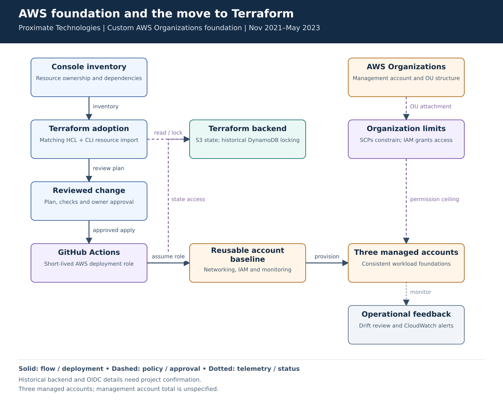
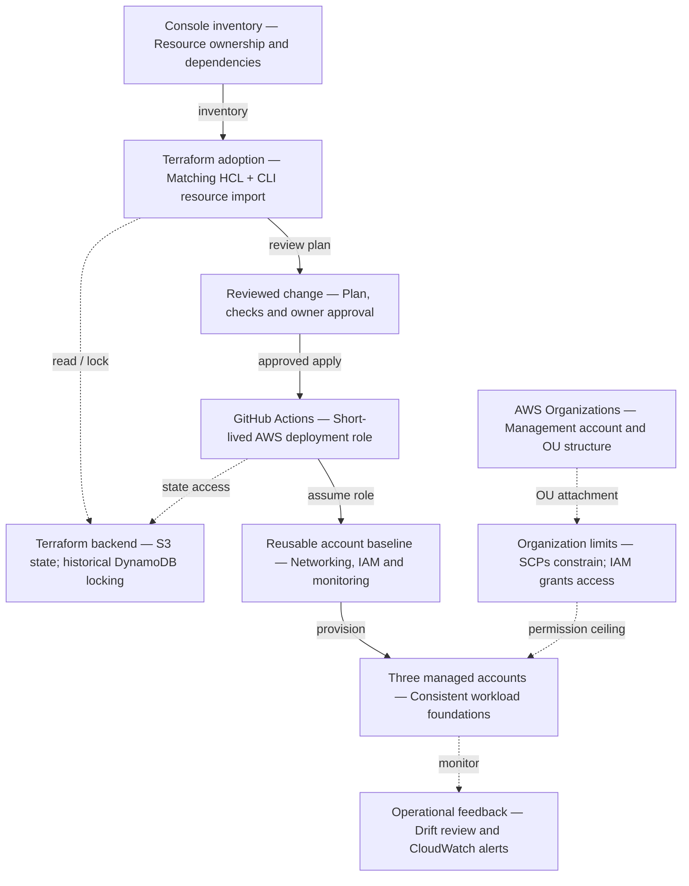

# AWS foundation and the move to Terraform

**Experience:** Proximate Technologies, November 2021–May 2023. **Focus:** AWS infrastructure, reusable baselines and adoption of infrastructure as code.

[Editable Mermaid](diagram.mmd) · [Vector diagram](diagram.svg)

## Problem and result

Console provisioning made environment delivery dependent on individual engineers. The resume records approximately **40% faster environment delivery across three AWS accounts** after reusable Terraform modules and GitHub Actions provisioning. This diagram explains the foundation and migration path behind that result. The separate **25 hours per month** of recovered automation effort is capacity, not a claim of cash savings.

## Walk-through

1. Inventory resources, dependencies and owners before bringing existing resources under Terraform.
2. Write configuration that matches the deployed resources. Use the period-appropriate `terraform import` CLI, then review a plan for unexpected replacement or deletion.
3. Move future changes through pull requests. Provision customer-owned networking and IAM baselines from reusable modules.
4. Give the pipeline a scoped deployment role. Review drift and monitor the resulting workloads.

| Boundary | Why it matters |
|---|---|
| Organizations and SCPs | Set an account-level permission ceiling. They do not grant access. |
| IAM deployment role | Grants the pipeline only the actions and resources needed for its scope. |
| Terraform state | Contains sensitive configuration; restrict readers, encrypt it and serialize writes. |
| Imported resources | Each physical resource needs one Terraform address. Import alone does not create suitable configuration. |

## Failure cases and tradeoffs

- Stop if the adoption plan proposes unexplained replacement. Back up state and reconcile the configuration before applying.
- A failed apply can leave partial changes. Inspect state and AWS before retrying; do not use a blanket destroy as recovery.
- Test organization policies on a limited OU before broad attachment. Review exception needs and avoid blocking service operation.

## Interview explanation

Start with the delivery bottleneck and the 40% result. Explain how existing resources were adopted safely, then show how reviewed changes became the normal path. Be ready to describe one resource whose import needed configuration correction and how drift was handled.

## Details to verify against your project

Three managed accounts are the confirmed footprint; the diagram does not infer the total organization account count. The S3/DynamoDB backend and short-lived deployment-role flow are reconstruction choices to verify. DynamoDB locking fits this historical period; current Terraform also supports S3 lockfiles. Do not describe Terraform import blocks or bulk import as tools used in this engagement.

## Technical references

- [Terraform resource import](https://developer.hashicorp.com/terraform/language/import/single-resource)
- [AWS SCP behavior](https://docs.aws.amazon.com/organizations/latest/userguide/orgs_manage_policies_scps.html)
- [GitHub Actions OIDC for AWS](https://docs.github.com/en/actions/how-tos/secure-your-work/security-harden-deployments/oidc-in-aws)

Mermaid source preview

