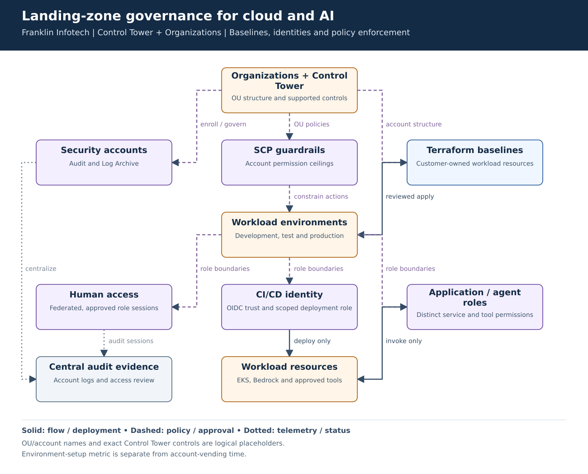
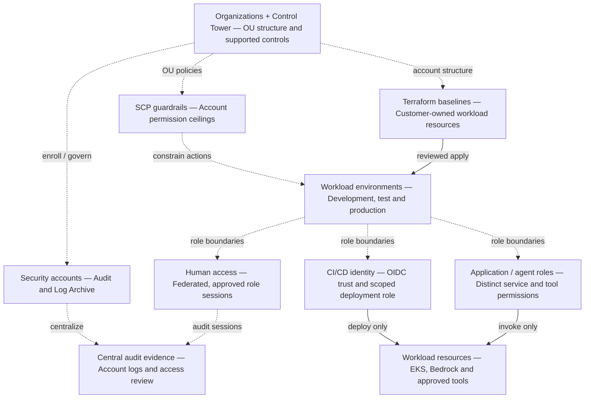

# Landing-zone governance for cloud and AI

**Experience:** Franklin Infotech, February 2024–March 2026. **Focus:** account foundations, controlled provisioning and distinct human, pipeline and AI identities.

[Editable Mermaid](diagram.mmd) · [Vector diagram](diagram.svg)

## Problem and result

Teams needed repeatable environments without broad permissions becoming the default. The resume records approximately **70% faster environment setup across development, test and production** through Terraform workload baselines and GitHub Actions. That result concerns environment setup; it is not a claim that Control Tower account vending became 70% faster.

## Walk-through

1. Establish the Organizations/Control Tower account structure and supported controls. Keep security-account responsibilities separate from application deployment.
2. Manage customer-owned workload baselines with Terraform. Do not overwrite Control Tower-managed resources with unrelated Terraform definitions.
3. Move console-created resources into reviewed configuration. Review policy and drift alongside infrastructure plans.
4. Separate human sessions, deployment identities and runtime identities. A pipeline can deploy a workload without that workload receiving deployment permissions.

| Control | Enforcement boundary |
|---|---|
| SCP | Limits available account permissions; never replaces IAM grants. |
| CI/CD OIDC trust | Binds an AWS role to an approved repository and branch or deployment environment. |
| Application / agent IAM role | Restricts AWS service calls; does not authorize every end user automatically. |
| Tool authorization | Checks user entitlement and operation scope outside the model. |
| Audit records | Supports investigation and control evidence without logging secrets or raw sensitive prompts. |

## Failure cases and tradeoffs

- Stage SCP changes in a canary OU. A deny can break an otherwise valid deployment; test expected allowed and denied calls before wider rollout.
- Control Tower enrollment and Terraform workload provisioning have different ownership. Repair the responsible layer rather than applying competing definitions.
- A policy finding is not proof of regulatory noncompliance. Track the specific issue, control owner, remediation and verification evidence.

## Interview explanation

Explain how landing zones made safe provisioning the default path. Point to the boundary between organization limits and IAM grants, then show why an agent role and a deployment role need different capabilities. Describe how teams moved from console changes to reviewed infrastructure changes.

## Details to verify against your project

The confirmed scope includes Control Tower, Organizations, Terraform migration and policy work. Exact OU names, account counts, federation provider, control identifiers and policy conditions were not provided. The drawing is a logical reconstruction, not an account inventory. Do not claim Account Factory for Terraform, Transit Gateway or HCP Terraform from this diagram.

PCI DSS and NIST AI RMF are the two resume framework references. Describe familiarity and concrete controls; do not imply certification, a client audit or a defined cardholder-data environment without evidence.

## Technical references

- [Terraform management of supported Control Tower controls](https://docs.aws.amazon.com/prescriptive-guidance/latest/patterns/deploy-and-manage-aws-control-tower-controls-by-using-terraform.html)
- [Control Tower foundations](https://docs.aws.amazon.com/controltower/latest/userguide/how-control-tower-works.html)
- [SCP evaluation and exceptions](https://docs.aws.amazon.com/organizations/latest/userguide/orgs_manage_policies_scps.html)

Mermaid source preview

