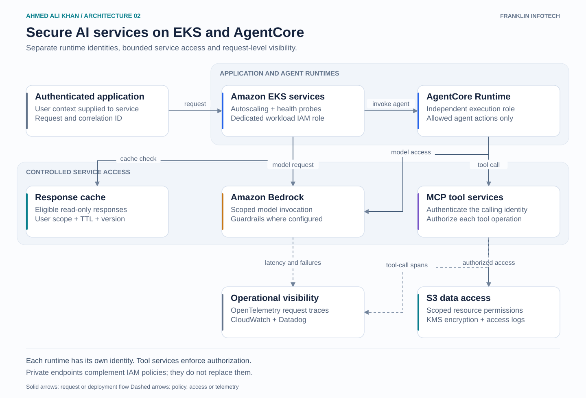

# Secure AI services on EKS and AgentCore

A runtime view of the AI platform. EKS application services and AgentCore use different identities, so deploying an agent does not give it the application service's permissions.

## Walkthrough

1. The application validates the caller and passes user context with a correlation ID. EKS services scale with demand and use readiness checks to avoid sending traffic to unhealthy instances.
2. A service can invoke an AgentCore runtime through an authorized AWS API call. AgentCore has its own execution role. This is a separate runtime boundary, rather than a migration sequence.
3. Each runtime receives only the Bedrock actions and data permissions it needs. MCP services authenticate requests and check access to the requested operation. The model's tool selection does not replace that check.
4. Private networking and VPC endpoint policies constrain supported service paths. IAM and resource policies still decide whether the operation is allowed.
5. OpenTelemetry follows the request and tool calls. CloudWatch and Datadog connect application symptoms with runtime health.

## Cost control

Model routing follows workload requirements. Cached responses are limited to suitable read-only requests, with identity-aware keys and expiry. Side-effecting operations bypass the cache. Cost dashboards show whether a change reduces spend without harming the service.

Platform scope: runtime deployment, identity, network access, capacity and incident diagnosis. Application developers own agent logic and tool behavior.
