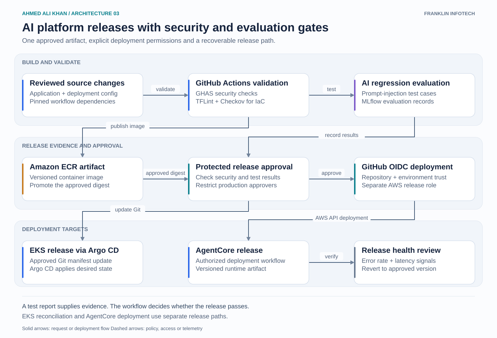

# AI platform releases with security and evaluation gates

A delivery flow for releasing AI application services with the same discipline as infrastructure changes. The gate uses security findings and AI regression results before allowing production deployment.

## Walkthrough

1. Reviewed source enters GitHub Actions. GitHub Advanced Security checks application changes, while TFLint and Checkov validate Terraform changes.
2. The workflow builds a versioned image and publishes it to ECR. The approved digest is the artifact promoted between environments.
3. Evaluation jobs exercise prompt-injection cases and expected tool-access behavior. MLflow provides a place to record evaluation runs and compare results. The workflow applies explicit pass/fail thresholds rather than treating a stored report as approval.
4. A protected environment controls the production release. OIDC trust is scoped to the approved repository and environment. Build jobs do not inherit production deployment permissions.
5. The EKS path updates the desired state in Git and Argo CD reconciles it. The AgentCore path uses its own authorized deployment workflow. Release checks compare service health with the previous version before promotion is considered complete.

## Recovery

Keep the previous approved digest and configuration available. A failed release is recovered by restoring that version through the deployment path. MLflow is evaluation tooling in this design, rather than a model-training pipeline.

Platform scope: workflow security, artifact promotion, evaluation plumbing, deployment access and recovery.
