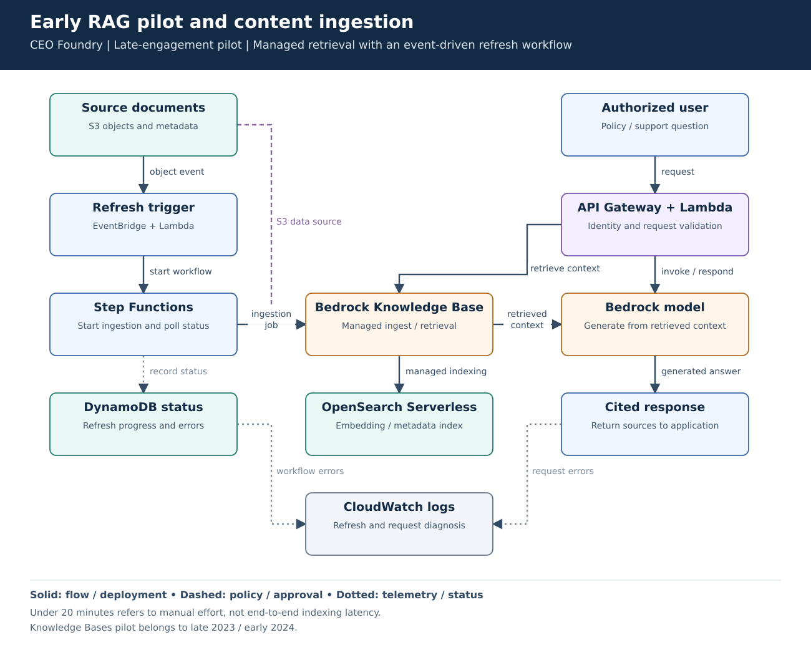
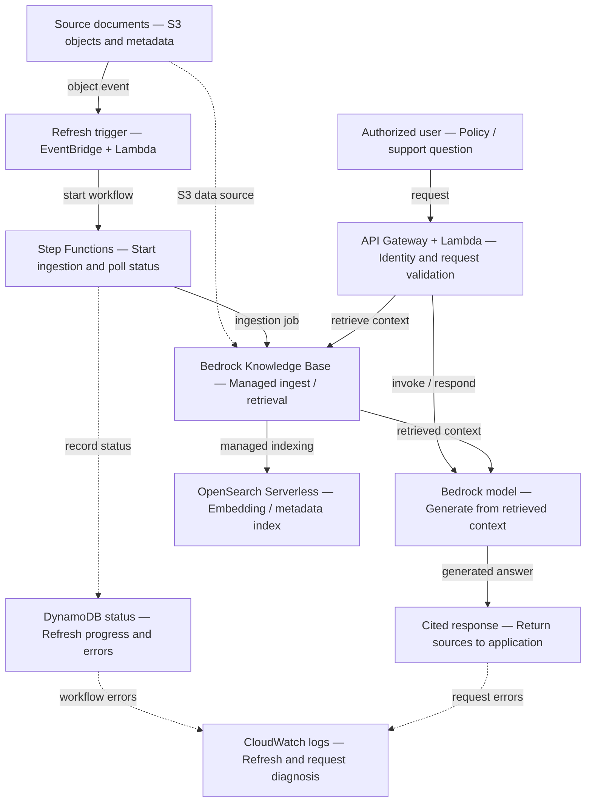

# Early RAG pilot and content ingestion

**Experience:** CEO Foundry, May 2023–February 2024. **Focus:** an early infrastructure and operations contribution to AI, rather than model development.

[Editable Mermaid](diagram.mmd) · [Vector diagram](diagram.svg)

## Problem and result

Content refreshes required manual handling. The resume records a reduction from several hours to **under 20 minutes of manual effort per refresh** through event-driven ingestion and metadata automation. This is a human-effort metric, not a promise that every indexing job completed within 20 minutes. The pilot also returned source citations for policy and support answers.

## Walk-through

1. An S3 content event starts a refresh workflow through EventBridge and Lambda.
2. Step Functions starts an asynchronous Knowledge Base ingestion job and checks its status. DynamoDB records refresh progress and failures.
3. The Knowledge Base owns the managed embedding/indexing path into OpenSearch Serverless. The application does not manually write vectors into the managed ingestion flow.
4. API Gateway/Lambda validates the caller and request, retrieves permitted context and invokes the Bedrock model. Return the answer with source references.

| Platform responsibility | Boundary |
|---|---|
| Terraform and CI/CD | Repeatable pilot environments, reviewed deployment and rollback. |
| IAM and KMS | Scoped service access and encryption permissions. |
| Application authorization | Enforces access to the endpoint and relevant documents outside the model. |
| Citation checks | Verifies source references; citations alone do not establish answer correctness. |

## Failure cases and tradeoffs

- Duplicate content events must not create uncontrolled concurrent refreshes. Use a refresh key/status check and bounded retries; confirm the project's actual deduplication mechanism.
- Treat ingestion failures as failed refreshes. Avoid silently presenting stale content as newly indexed; surface the last successful refresh.
- Restrict retrieval to the caller's approved corpus or enforce entitlement filtering. Validate access before generation and avoid relying on prompt instructions for authorization.

## Interview explanation

Describe the manual refresh problem, then follow the two paths: document ingestion and a user query. Emphasize provisioning, orchestration and operational visibility. Explain how you measured human effort separately from ingestion latency.

## Details to verify against your project

Bedrock Knowledge Bases became generally available late in 2023, so this belongs to the latter part of the engagement. Confirm the exact event rule, status schema, API orchestration and retrieval method. The diagram intentionally does not show AgentCore, MCP or a mature production agent platform in this early role.

## Technical references

- [Bedrock Knowledge Bases](https://docs.aws.amazon.com/bedrock/latest/userguide/knowledge-base.html)
- [StartIngestionJob API](https://docs.aws.amazon.com/bedrock/latest/APIReference/API_agent_StartIngestionJob.html)
- [Bedrock IAM](https://docs.aws.amazon.com/bedrock/latest/userguide/security-iam.html)

Mermaid source preview

