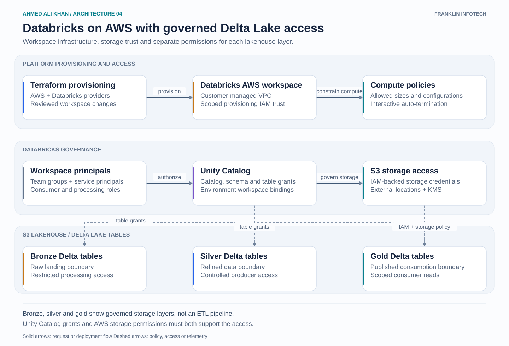

# Databricks on AWS with governed Delta Lake access

A platform view of a Databricks lakehouse on AWS. Bronze, silver and gold are access boundaries for Delta Lake tables stored in S3. Transformation code is outside this diagram.

## Walkthrough

1. Terraform provisions the AWS workspace foundation and Databricks configuration. Workspace provisioning trust is separate from the IAM credentials used to access lakehouse data.
2. The customer-managed VPC establishes the network boundary. Compute policies limit allowed configurations and require auto-termination for interactive clusters where appropriate.
3. Groups and service principals receive Unity Catalog permissions for their purpose. Processing identities can write to the layers they own. Consumers receive read access to the published tables they need.
4. Storage credentials connect Unity Catalog to scoped IAM roles. External locations constrain the S3 paths governed by those credentials. S3 and KMS permissions must allow the corresponding operation as well.
5. These controls apply across the lakehouse layers. The diagram shows the table grants across all three layers and highlights the IAM-backed gold storage path. The same storage constraints apply to bronze and silver.

## Design decision

Separate provisioning privileges from data access. Avoid broad direct S3 permissions that let workloads bypass the intended Unity Catalog access path. Workspace bindings help control which environments can use a catalog.

Platform scope: workspace deployment, IAM trust, networking, compute policies and lakehouse governance. Data teams own the transformations and the bronze-to-silver-to-gold processing jobs.
