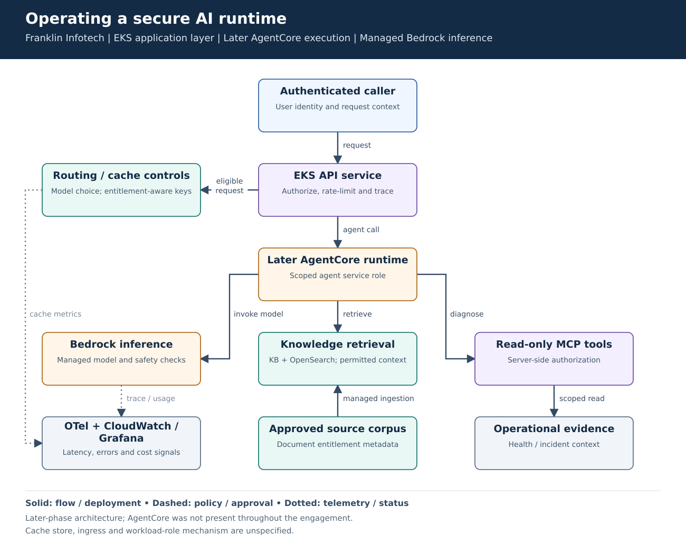
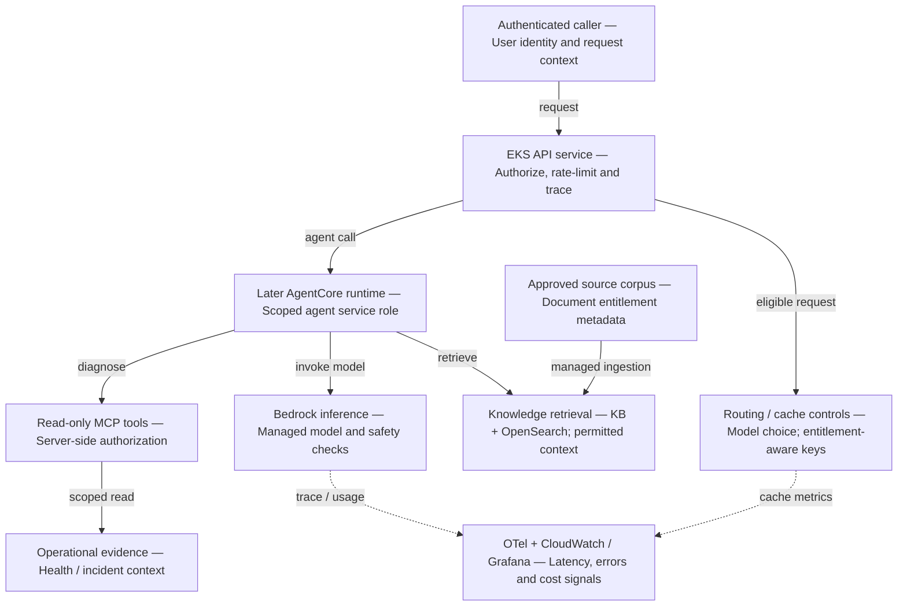

# Operating a secure AI runtime

**Experience:** Franklin Infotech, February 2024–March 2026. **Focus:** service reliability, cost controls and AI workload identity.

[Editable Mermaid](diagram.mmd) · [Vector diagram](diagram.svg)

## Problem and result

The resume records **99.9% availability** for roughly **2,500 users and 200,000+ monthly queries**, alongside approximately **30% lower monthly AI platform run cost**. EKS hosted the application API; AgentCore entered later for agent execution. Managed Bedrock inference is distinct from both application hosting and agent hosting.

## Walk-through

1. The API validates the caller, authorizes the requested operation and propagates a trace identifier. EKS autoscaling and health probes support the application layer.
2. Apply model-routing and caching controls where the request permits them. Cache keys must include authorization context and relevant corpus/configuration version; never share restricted answers across users accidentally.
3. The later AgentCore runtime invokes approved models, knowledge retrieval and read-only MCP diagnostic tools under scoped service permissions.
4. Tool servers validate the trusted user/session context and operation scope themselves. Model-generated tool arguments are untrusted input.
5. Collect latency, errors and usage signals without indiscriminately retaining sensitive prompt bodies.

| Security boundary | What it prevents |
|---|---|
| Caller authorization | A valid service role being mistaken for user entitlement. |
| Separate runtime roles | An agent receiving the infrastructure pipeline's deployment permissions. |
| Scoped MCP endpoint | A diagnostic operation becoming an unrestricted shell or AWS API proxy. |
| Retrieval entitlement checks | Restricted documents entering an unauthorized user's context. |
| Guardrails / PII controls | Some content risks; these do not replace IAM or tool authorization. |

## Failure cases and tradeoffs

- Retry only safe operations and apply bounded backoff on throttling. Set timeouts and concurrency limits so slow model calls do not exhaust the API.
- Track upstream/model errors separately from EKS health. Pod health alone cannot establish end-to-end availability.
- Invalidate or version caches when documents, entitlements or AI configuration change. Savings are not useful if answers become stale or access controls are bypassed.

## Interview explanation

Start with reliability and cost at the stated traffic scale. Explain the application/runtime/model distinction. Then trace an unauthorized tool request and show where it is rejected independently of the model's response.

## Details to verify against your project

This is the later architecture, not the architecture for all of February 2024 onward. Confirm migration timing, authentication mechanism, EKS ingress, workload-role mechanism and the actual cache store. Those details are intentionally logical rather than invented product selections. Verify the availability measurement window, cost denominator and model mix before defending the metrics.

## Technical references

- [AgentCore IAM policy examples](https://docs.aws.amazon.com/bedrock-agentcore/latest/devguide/security_iam_id-based-policy-examples.html)
- [EKS best practices](https://docs.aws.amazon.com/eks/latest/best-practices/introduction.html)
- [Bedrock Knowledge Bases](https://docs.aws.amazon.com/bedrock/latest/userguide/knowledge-base.html)

Mermaid source preview

