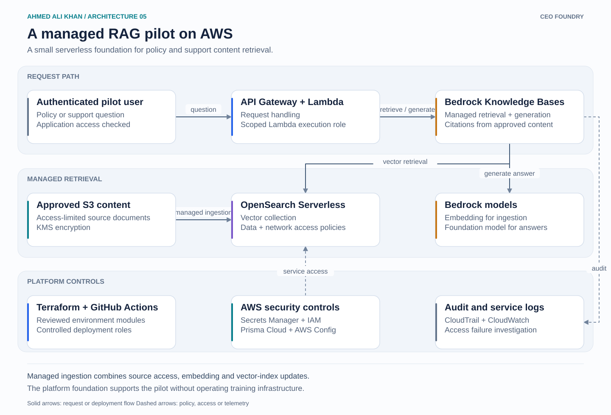

# A managed RAG pilot on AWS

A late-2023 pilot foundation using managed retrieval instead of operating a separate search and model-serving stack. The focus is the AWS deployment and security boundary around the application.

## Walkthrough

1. An authenticated user sends a question to the application. API Gateway invokes Lambda, which handles the request under a scoped execution role.
2. Approved source documents are held in S3. A Knowledge Bases ingestion job reads the content, creates embeddings through Bedrock and stores them in the OpenSearch Serverless vector collection. The ingestion arrow summarizes that managed job, rather than a direct S3-to-OpenSearch transfer.
3. The application uses Knowledge Bases to retrieve relevant content and generate an answer with source citations. The knowledge-base service role receives the permissions required for the collection and source content.
4. Terraform modules and GitHub Actions keep environment configuration repeatable. Secrets Manager removes credentials from application configuration where credentials are needed.
5. AWS Config and Prisma Cloud surface configuration issues. CloudTrail and CloudWatch support access investigations and application troubleshooting. Selected NIST SP 800-53 controls guide configuration reviews.

## Design decision

Managed retrieval keeps the pilot's operating footprint small. Source approval and access policies are still required. Citations support review of an answer, but do not establish that the answer is correct.

Platform scope: infrastructure, deployment, IAM, encrypted storage and operational support. Content curation and retrieval tuning belong to the application team.
