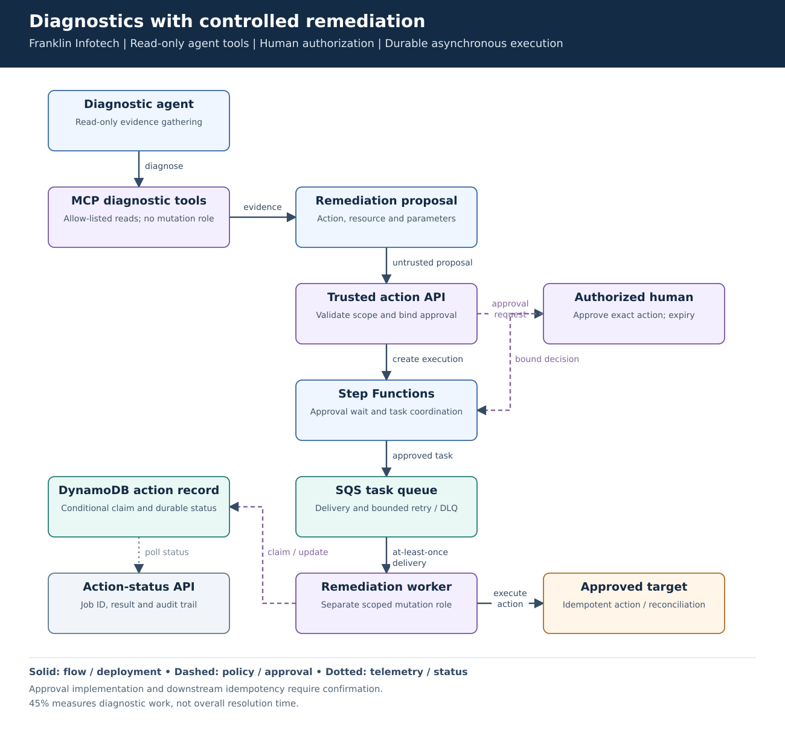
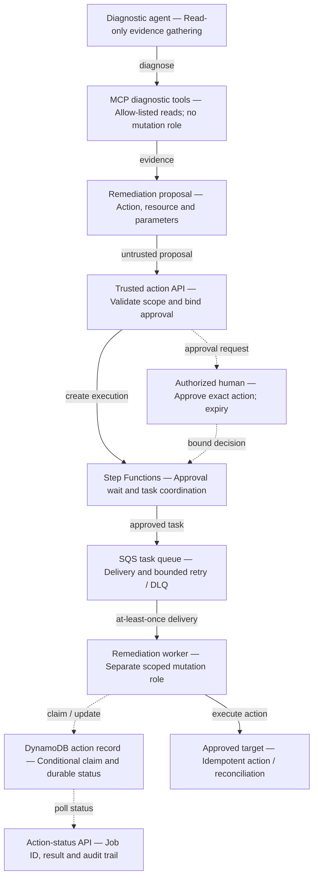

# Diagnostics with controlled remediation

**Experience:** Franklin Infotech. **Focus:** faster operational diagnosis with a separate, accountable write path.

[Editable Mermaid](diagram.mmd) · [Vector diagram](diagram.svg)

## Problem and result

The resume records approximately **45% less time spent on incident classification and evidence gathering** through read-only MCP diagnostics. This metric is not a claim of 45% lower incident resolution time. The remediation path shown here explains how proposed writes can be approved and executed without granting the diagnostic agent a general mutation role.

## Walk-through

1. Read-only tools gather scoped operational evidence. The agent can propose a remediation but cannot authorize it.
2. A trusted action API validates the action type, target resource and caller entitlement. Bind approval to the exact normalized parameters, approver and expiry; changed parameters require new approval.
3. Step Functions coordinates the approved workflow. SQS delivers worker tasks; it is not the approval system or workflow state store.
4. The worker claims the action conditionally in DynamoDB and uses a separate scoped mutation role. Status is queryable through an action ID.
5. Make the downstream operation idempotent where possible. If execution outcome is uncertain, reconcile before another write rather than blindly retrying.

| Component | Responsibility |
|---|---|
| Step Functions | Workflow progression, waits, timeout and task coordination. |
| SQS | Task delivery, visibility timeout, retry and dead-letter handling. |
| DynamoDB | Durable application action record and conditional claim. |
| Worker / target API | Actual write permission and safe repeated execution. |
| Approval service | Verifies the authorized approver and the exact action approved. |

## Failure cases and tradeoffs

- SQS can deliver a task more than once. A DynamoDB lock by itself does not guarantee exactly-once effects across an external API.
- A worker can crash after the target changes but before recording success. Use a target idempotency token or inspect/reconcile the target before replay.
- Expired/rejected approvals must not enqueue writes. Protect any callback token; do not put it in agent prompts or broad-access logs.
- Quarantine tasks that exhaust retries. Investigate and authorize replay rather than treating the dead-letter queue as an automatic retry loop.

## Interview explanation

Trace a proposed action from diagnostic evidence to approval and execution. Explain why the agent cannot acquire the worker's role. Then walk through the crash-after-write case; this exposes whether idempotency is designed beyond a queue and database.

## Details to verify against your project

The resume confirms the approval-gated Step Functions/SQS/DynamoDB pattern. Exact approval UI, callback integration, action schema, worker runtime and downstream idempotency mechanism need project confirmation. This is an implementation-level reconstruction, not production code or a claim of exactly-once delivery.

## Technical references

- [Step Functions callback integrations](https://docs.aws.amazon.com/step-functions/latest/dg/connect-to-resource.html#connect-wait-token)
- [SQS at-least-once delivery](https://docs.aws.amazon.com/AWSSimpleQueueService/latest/SQSDeveloperGuide/standard-queues-at-least-once-delivery.html)
- [DynamoDB condition expressions](https://docs.aws.amazon.com/amazondynamodb/latest/developerguide/Expressions.ConditionExpressions.html)

Mermaid source preview

