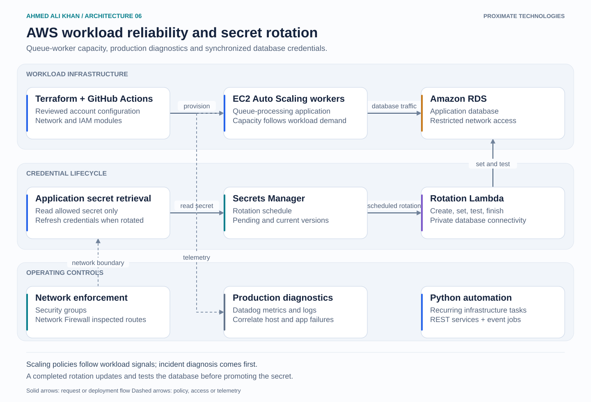

# AWS workload reliability and secret rotation

An operating view of EC2 application workers and their RDS credentials. Infrastructure changes, application troubleshooting and credential rotation meet at the same workload boundary.

## Walkthrough

1. Reviewed Terraform modules provision the worker fleet and its account, network and IAM configuration. Auto Scaling policies follow the queue application's capacity requirements.
2. Datadog combines host signals with application logs during incidents. This helps distinguish exhausted worker capacity from an application failure before changing a scaling policy.
3. Applications read an allowed secret from Secrets Manager instead of carrying hardcoded credentials. Their refresh behavior must account for a completed rotation.
4. Secrets Manager invokes a rotation Lambda on a schedule. The function creates a pending value, changes the database credential, tests it and promotes the version only after success. Private connectivity and permission to the specific secret are required.
5. Security groups protect the workload boundary. Where centralized inspection is required, route tables send traffic through AWS Network Firewall endpoints with a symmetric return path.

## Design decision

Scaling is useful when workload demand is the cause. Metrics and logs are needed to avoid scaling a broken application. Database rotation also needs a tested application refresh path, rather than only a successful Lambda invocation.

Platform scope: infrastructure automation, capacity policies, secrets, network rules and incident support.
