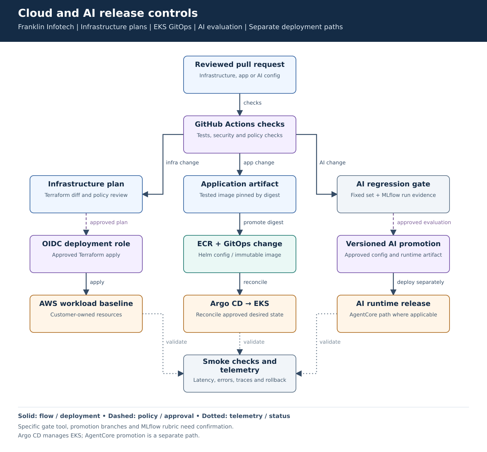
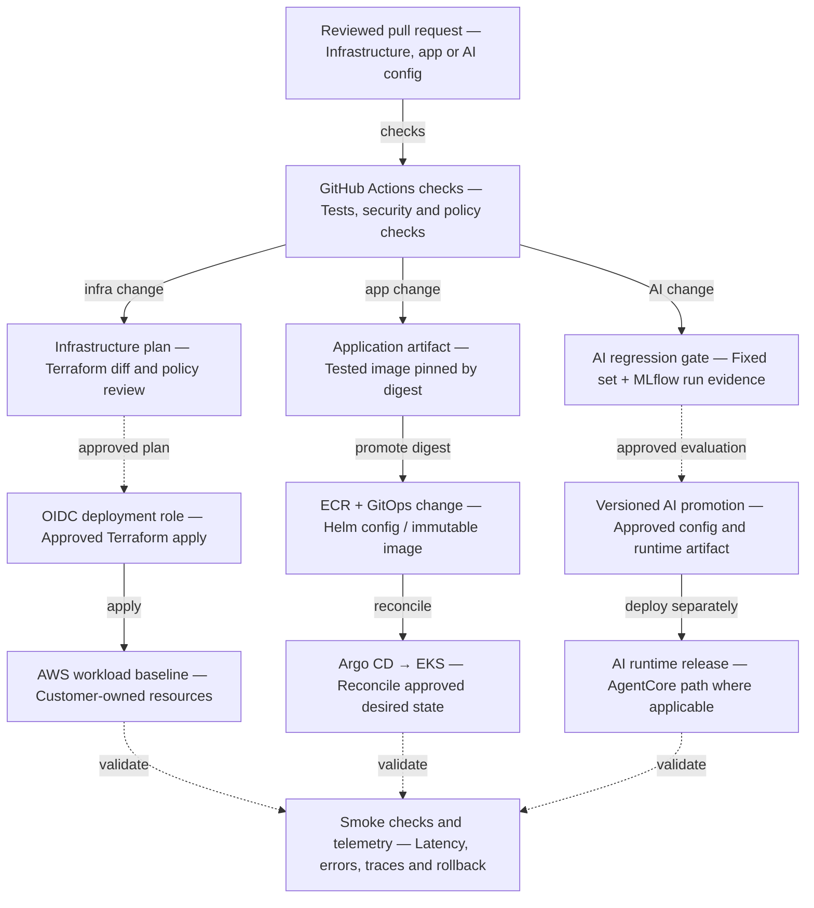

# Cloud and AI release controls

**Experience:** Franklin Infotech. **Focus:** repeatable infrastructure changes, safe application delivery and AI regression checks.

[Editable Mermaid](diagram.mmd) · [Vector diagram](diagram.svg)

## Problem and result

The resume records approximately **70% faster environment setup**, **24 security/AI-governance findings addressed** and a fixed-set groundedness pass rate improving from approximately **70% to 90%**. These are separate measurements. The diagram shows how platform release controls support the work; it does not claim that CI/CD alone caused every result.

## Walk-through

1. Pull requests run relevant application tests, infrastructure checks and security scanning. Policy checks inspect proposed infrastructure and access changes.
2. Terraform changes receive plan review before an approved apply through a scoped AWS role. Avoid re-planning a materially different change silently after approval.
3. Application builds produce a pinned image digest. A reviewed GitOps change updates Helm configuration; Argo CD reconciles the EKS deployment.
4. AI changes run against a versioned evaluation set with MLflow evidence. Review quality alongside operational limits such as latency and cost; promote an approved version.
5. An AgentCore runtime release follows its own deployment path. Argo CD does not deploy a managed AgentCore runtime as an EKS workload.
6. Validate releases through smoke checks and production telemetry. Roll back the relevant application/configuration version; infrastructure changes may need a reviewed forward repair.

| Concern | Design choice |
|---|---|
| Pipeline identity | Short-lived OIDC session with repository/environment trust and scoped permissions. |
| Artifact integrity | Immutable image digest; separate build from promotion. |
| AI regression evidence | Fixed, versioned examples and a defined scoring rubric. Avoid tuning to the same test cases repeatedly. |
| Access separation | Runtime roles do not inherit deployment permissions. |
| Recovery | Component-specific rollback; no universal destroy/recreate procedure. |

## Failure cases and tradeoffs

- A passing average quality score can hide an unsafe access case. Keep critical authorization and prompt-injection checks as blocking failures.
- Terraform plan output and CI logs can contain sensitive values. Restrict retention/access and avoid printing credentials or raw sensitive prompts.
- A low-quality release should not advance because the image deploys successfully. Validate the behavior and telemetry after deployment as well as the build.

## Interview explanation

Use one infrastructure change and one AI configuration change to explain the different gates. Show where approval binds to the artifact or plan. Discuss how you would revert an application release versus repair a failed infrastructure apply.

## Details to verify against your project

Confirm the exact Argo CD ownership, promotion branches, policy tool, MLflow scoring rubric and pipeline role trust. The diagram names no unconfirmed policy product, artifact-signing tool or evaluation library. It represents the release-control pattern to validate against the actual project, not an executable deployment workflow.

## Technical references

- [GitHub OIDC for AWS](https://docs.github.com/en/actions/how-tos/secure-your-work/security-harden-deployments/oidc-in-aws)
- [Argo CD declarative configuration](https://argo-cd.readthedocs.io/en/stable/operator-manual/declarative-setup/)
- [MLflow evaluation documentation](https://mlflow.org/docs/latest/genai/eval-monitor/)

Mermaid source preview

