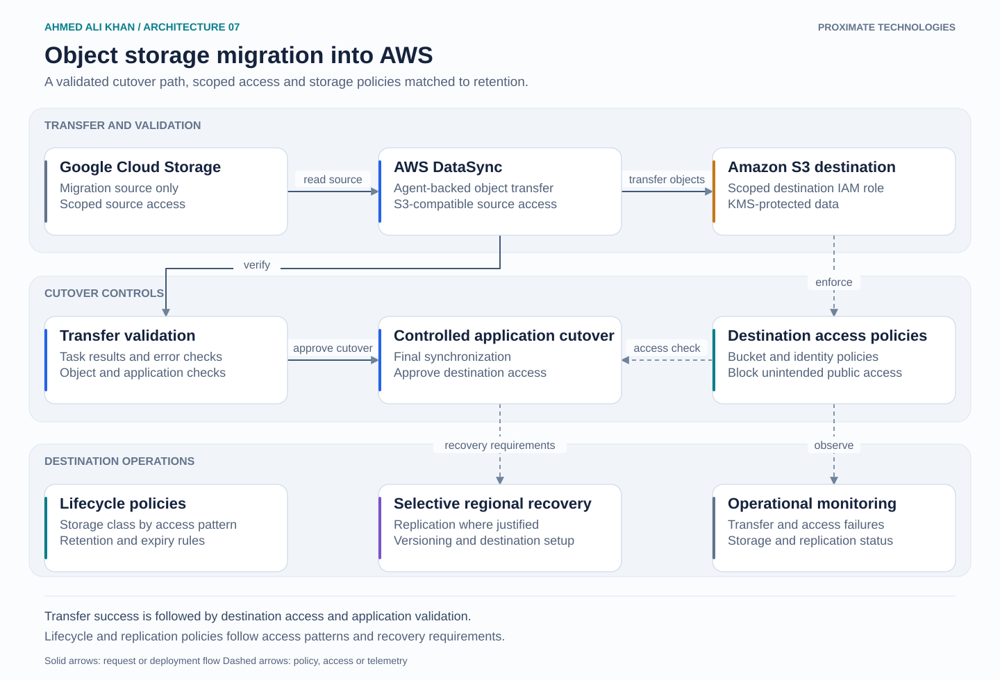

# Object storage migration into AWS

A migration from Google Cloud Storage to an AWS application storage boundary. The source is a migration endpoint, while S3 becomes the destination operated by the platform team.

## Walkthrough

1. Configure the source object access and DataSync agent connectivity. Use an allowed source credential and a destination role scoped to the S3 bucket. Cloud-provider object storage details determine the required endpoint configuration.
2. Run the transfer and inspect DataSync task results. Validate destination objects, metadata expectations and application reads before switching the application to S3.
3. Coordinate a final synchronization with the application's write behavior. Destination IAM, bucket policies and KMS grants must be ready before cutover. A completed transfer alone does not establish application compatibility.
4. Apply storage classes and lifecycle policies according to access frequency and retention requirements. Retrieval charges and minimum storage durations affect that choice.
5. Use cross-Region replication only where recovery requirements justify it. Set up versioning and replication permissions on both sides. Existing objects may require a separate backfill.

## Design decision

Keep cutover approval separate from data transfer completion. Source availability and rollback timing are cutover decisions, while long-term lifecycle and replication policies are destination operating decisions.

Platform scope: transfer configuration, validation, S3 permissions, lifecycle policy and recovery controls.
