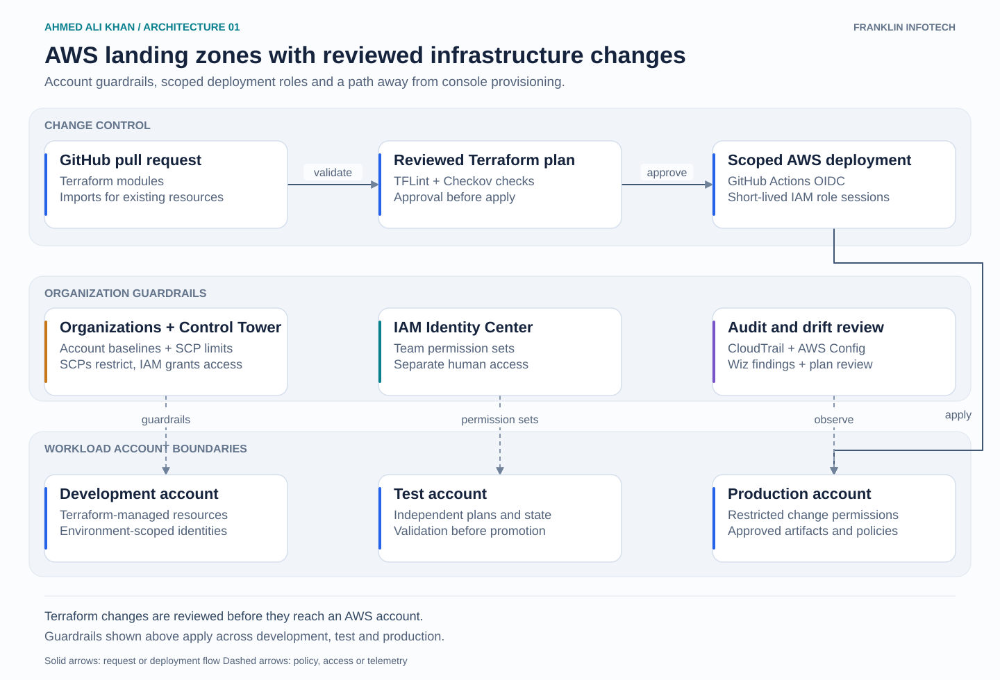

# AWS cloud and AI platform architecture

Ahmed Ali Khan · Cloud AI Platform Engineer

Architecture diagrams covering AWS infrastructure, secure AI operations and Databricks platform governance. Each view focuses on service boundaries and the decisions that make the platform operable. Client details, environment identifiers and internal policy documents are omitted. These are simplified architecture views, rather than deployment manifests.

## Architecture walkthroughs

| Architecture | Focus |
| --- | --- |
| [AWS landing zones](01-aws-landing-zones/README.md) | Account guardrails, Terraform adoption and scoped deployment access. |
| [Secure AI runtime](02-secure-ai-runtime/README.md) | EKS, AgentCore identities, Bedrock access and tool-call visibility. |
| [AI platform releases](03-ai-platform-release-gates/README.md) | Security checks, evaluation evidence and protected promotion. |
| [Databricks lakehouse governance](04-databricks-lakehouse-governance/README.md) | Workspace infrastructure, Unity Catalog and Delta Lake storage access. |
| [Early managed RAG pilot](05-ceo-foundry-rag-pilot/README.md) | Serverless deployment and security around a small retrieval application. |
| [AWS workload operations](06-aws-workload-operations/README.md) | EC2 capacity, production diagnostics and RDS secret rotation. |
| [S3 migration and storage](07-s3-migration-storage-controls/README.md) | Validated cutover, lifecycle decisions and selective replication. |

Open a walkthrough for the full diagram and a brief explanation of the flow. The SVGs remain sharp when enlarged and can be downloaded from each folder.

The platform scope is infrastructure, identity, delivery and operations. Application teams own business logic and agent behavior. Data teams own lakehouse transformations.

[GitHub](https://github.com/ahmedalikhancloud) · [LinkedIn](https://www.linkedin.com/in/ahmedalikhancloud)
